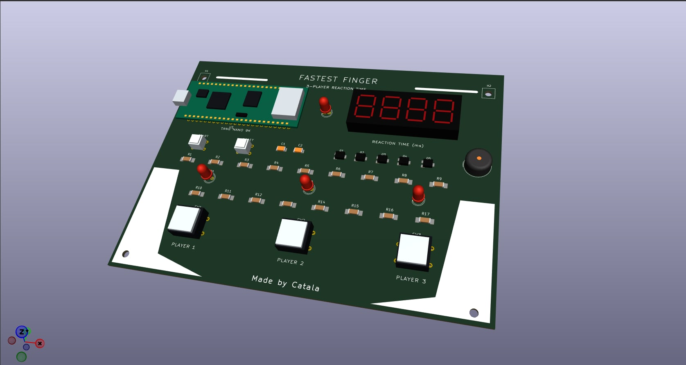
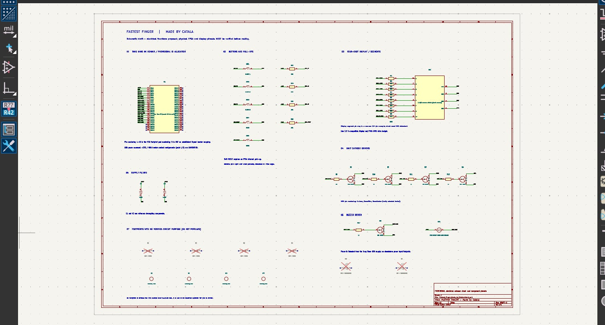

# FASTEST FINGER — Made by Catala

This is an **editable KiCad PCB Editor board layout** recreated from the supplied reference image.

**Changes from the reference**
- All six names across the top have been removed.
- The bottom-center text now reads **Made by Catala**.
- The original title, three-player layout, approximate placement, and white decorative graphics are retained.

## PCB 3D Preview

The 3D visualization of the Fastest Finger PCB design created using KiCad.

## Schematic Diagram

The preliminary schematic diagram of the Fastest Finger circuit designed using KiCad Schematic Editor.

## Open in KiCad

1. Extract the whole ZIP; keep the `models` folder with the project files.
2. In KiCad Project Manager choose **File → Open Project** and select `Fastest_Finger_Made_by_Catala.kicad_pro`.
3. Double-click `Fastest_Finger_Made_by_Catala.kicad_pcb` from the project tree, or choose the PCB Editor shortcut.
4. In PCB Editor, use **View → 3D Viewer** (`Alt+3` on many systems) to see the approximate component models.
5. Edit text and locations directly on the **F.SilkS** and other PCB layers.
6. Open **Schematic Editor** to view or modify the `.kicad_sch` file.

Alternatively, start standalone PCB Editor and use **File → Open** to select the `.kicad_pcb` file. Do not try to select `.kicad_pcb` from KiCad Project Manager's **Open Project** file dialog, which filters for `.kicad_pro`.

## Hardware Components

| Component | Quantity |
|-----------|----------|
| Tang Nano 9K FPGA Board | 1 |
| 4-Digit 7-Segment Display | 1 |
| Player Push Buttons | 3 |
| START Button | 1 |
| RESET Button | 1 |
| NPN Transistors | 5 |
| Resistors | 17 |
| Capacitors | 2 |
| Diodes | 4 |
| LEDs | 2 |
| Buzzer | 1 |
| Mounting Holes | 4 |
| Printed Circuit Board | 1 |

## Important Limitation

This is a **visual/layout reconstruction with a preliminary schematic, not a verified, manufacturing-ready electronic design**.

The electrical connections, FPGA pin assignments, component values, and control wiring require verification. PCB traces are not fully routed, and FPGA code is not included.

Do not send the PCB for fabrication or assume functionality without verifying the actual circuit.

Real footprints and dimensions must be checked against the specific parts to be installed, especially the four-digit display, buttons, buzzer, and diodes. Visual models are approximations, not manufacturer STEP models.

- Board nominal dimensions: **174 mm × 128 mm**.
- Tang Nano 9K: represented by a **2 × 24 pin, 2.54 mm pitch** carrier footprint.
- Editable silkscreen labels and PCB features are part of the `.kicad_pcb` file.

---

**Made by Catala**
